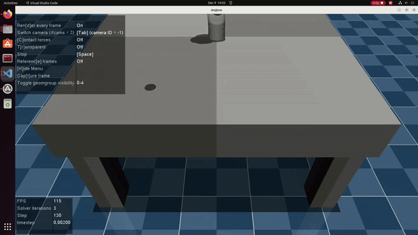
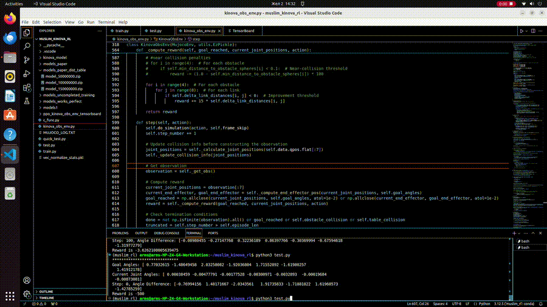
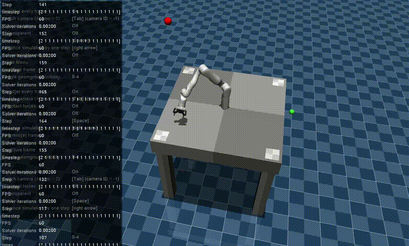

# Reinforcement Learning for the Kinova Gen3: Reaching and Obstacle Avoidance



A simulation study of reinforcement learning for a 7-DoF Kinova Gen3 arm in MuJoCo, trained with PPO (Stable-Baselines3). The repository collects three related environments that form a progression in problem formulation, from obstacle-free reaching to multi-obstacle avoidance to single-obstacle dynamic avoidance with curriculum learning.

Each environment is a distinct formulation with its own observation space, reward design, scene, and trained models. They are kept side by side on purpose: each one represents a separate experiment and a separate set of results, not stages of a single model.

This is a simulation-only study (no hardware deployment), developed as part of a supervised research effort on learning-based motion planning and obstacle avoidance for robotic manipulators.

**Key tools:** MuJoCo, Gymnasium, Stable-Baselines3, NumPy

---

## The three environments

| Environment | Obstacles | Observation | Core idea |
|---|---|---|---|
| `reaching` | none | 21D | Joint-space goal reaching baseline |
| `multi_static_obstacle` | 4 static | 76D | Per-link distance shaping and collision penalties |
| `dynamic_obstacle` | 1 static or moving | 24D | Safety-distance reward with curriculum learning |

---

## 1. Reaching (baseline)

Obstacle-free joint-space reaching. The agent moves the arm from a random initial configuration to a randomly sampled joint-space goal.

- **Observation (21D):** joint positions (7), joint velocities (7), joint error to goal (7).
- **Reward:** a positive reward on reaching the goal, otherwise a shaping term on joint-space distance to the goal plus a small action-regularization penalty for smoother trajectories.
- **Models:** `reaching/models/`

[](reaching/assets/reaching.gif)

---

## 2. Multi-static-obstacle avoidance

Joint-space reaching while avoiding four fixed spherical obstacles, with explicit collision checks against both the obstacles and the table.

- **Observation (76D):** joint positions (7), joint velocities (7), joint error to goal (7), the four obstacle positions (12), per-obstacle minimum distances (4), per-obstacle collision flags (4), an obstacle-collision flag (1), a table-collision flag (1), per-link distance changes across the eight test points and four obstacles (32), and end-effector distance to goal (1).
- **Reward:** large penalties for obstacle and table collisions, a positive reward on reaching the goal, joint-space and end-effector distance shaping, and a per-link term that rewards increasing the distance between arm links and obstacles over time.
- **Models:** `multi_static_obstacle/models/`. The trained policy is included, but the VecNormalize statistics from its run were not preserved. Since this environment was trained on normalized observations and those running statistics cannot be reconstructed from the policy, a correct evaluation requires retraining with `train.py` (which saves the stats at the end of the run). See the note under Quick start for a raw-observation render that does not reflect trained performance.

[](multi_static_obstacle/assets/static_obstacle_demo.mp4)

---

## 3. Dynamic-obstacle avoidance with curriculum

Joint-space reaching while avoiding a single obstacle that can be static or moving, trained with a curriculum that increases difficulty over the course of training.

- **Observation (24D):** joint positions (7), joint velocities (7), joint error to goal (7), distance to the obstacle (1), an obstacle-collision flag (1), and end-effector distance to goal (1).
- **Reward:** a safety term that grows as the arm approaches the obstacle, a target term on joint-space distance to goal, terminal rewards for reaching the goal or hitting the obstacle, and an energy term on joint velocity. A smooth blending factor based on the distance to the obstacle shifts the balance between making progress toward the goal and conserving motion near obstacles.
- **Curriculum:** training begins with a static obstacle (stage 0) and switches to a moving obstacle (stage 1) via a callback that advances the stage after a set number of timesteps. A mixed mode samples static or moving per episode.
- **Models:** `dynamic_obstacle/models/`

[](dynamic_obstacle/assets/dynamic_obstacle_demo.mp4)

---

## Repository structure

```
reinforcement-learning-with-kinova/
├── common/
│   ├── __init__.py
│   └── callbacks.py                   # Checkpointing + curriculum/CSV-logging callbacks
├── kinova_fk.py                       # Analytic Python FK, used by the reaching env
├── c_func.py                          # CasADi-generated FK, used by both obstacle envs
├── kinova_model_reaching/             # MuJoCo scene for reaching (no obstacles)
│   └── scene.xml
├── kinova_model_static/               # MuJoCo scene for multi-static (four spheres)
│   └── scene.xml
├── kinova_model_base/                 # MuJoCo scene for dynamic
│   └── scene.xml
├── reaching/
│   ├── __init__.py
│   ├── env.py                         # 21D reaching environment (ReachingEnv)
│   ├── assets/                        # demo gif
│   └── models/                        # Trained PPO checkpoints + vec_normalize_stats.pkl
├── multi_static_obstacle/
│   ├── __init__.py
│   ├── env.py                         # 76D, four static obstacles (MultiStaticObstacleEnv)
│   ├── assets/
│   └── models/
├── dynamic_obstacle/
│   ├── __init__.py
│   ├── env.py                         # 24D, static/dynamic obstacle + curriculum (DynamicObstacleEnv)
│   ├── assets/
│   └── models/
├── configs.py                         # Per-env config registry
├── train.py                           # --env {reaching, multi_static, dynamic}
├── test.py                            # --env {reaching, multi_static, dynamic}
├── requirements.txt
└── README.md
```

All commands are run from the repository root, so the forward-kinematics modules (`kinova_fk.py`, `c_func.py`) and the MuJoCo scene folders (`kinova_model_reaching/`, `kinova_model_static/`, `kinova_model_base/`) live at the root where the environment code expects to find them. The reaching and multi-static scenes are kept in separate folders because their scene files differ: the multi-static scene contains the four obstacle spheres, while the reaching scene has none.

---

## Forward kinematics

The repository uses two forward-kinematics implementations, matching what each environment was actually trained against. They are deliberately not unified.

- The reaching environment uses an analytic Python implementation in `kinova_fk.py`, which returns the end-effector pose. Reaching only needs the end-effector pose to check that a sampled joint-space goal falls inside the workspace.
- The two obstacle environments use a CasADi-generated function in `c_func.py`, which returns the end-effector pose together with the positions of eight test points along the arm. The obstacle environments use those test points to compute link-to-obstacle distances for their safety and shaping terms.

Each environment applies its own vertical offset to account for the robot mount height in its MuJoCo scene, since that offset is not baked into either kinematics module: 0.6 for reaching, 0.5 for multi-static, and 1.2 for dynamic. Because each trained policy depends on the exact kinematics, offset, scene, and workspace bounds it was trained with, the two modules are kept separate and are not interchangeable.

---

## Quick start

```bash
pip install -r requirements.txt

# Evaluate a trained policy with a rendered rollout
python test.py --env reaching --model reaching/models/reaching_ppo.zip
python test.py --env dynamic  --model dynamic_obstacle/models/dynamic_ppo.zip --stage 0
```

Reaching and dynamic ship with policies that run from a fresh clone. Multi-static ships with its policy but not its VecNormalize stats, so evaluating it correctly requires retraining first (see below). For a quick render of multi-static without the stats, which shows the scene and motion but not trained performance:

```bash
python test.py --env multi_static --model multi_static_obstacle/models/multi_static_ppo.zip --no-normalize
```

To train from scratch:

```bash
# Select the environment: reaching, multi_static, or dynamic
python train.py --env dynamic
```

Training uses PPO with vectorized parallel environments and periodic checkpointing. Each environment writes its checkpoints to its own `models/` directory.

### A note on parallel environments

All three environments use `SubprocVecEnv` with a modest `n_envs` (30). Each MuJoCo model opens roughly sixteen mesh files when it compiles, so building many environments in a single process (as `DummyVecEnv` does) can exhaust the OS open-file limit, which MuJoCo reports as a resource-not-found error on a mesh that is actually present. Subprocess workers spread the environments across processes and avoid this. If you raise `n_envs` substantially or switch back to a single-process vec env, raise the file limit first (for example `ulimit -n 65535`).

---

## Results

Results are currently shown qualitatively through the demo videos above: successful goal reaching in the baseline, and collision-free goal reaching in the static and dynamic obstacle settings. Quantitative success and collision rates per environment are planned.

Of the three, reaching and dynamic run from a fresh clone with their included policies. Multi-static includes its policy but not its normalization statistics, so its quantitative results are reproducible by retraining rather than by loading the shipped policy directly.

---

## Limitations

- Simulation only; no sim-to-real transfer.
- State-based (non-visual) observations.
- Obstacles are modeled as spheres, and the table is the only fixed body in the collision checks.
- Workspace bounds are simple and do not replace full collision-aware motion planning.

---

## Future work

- Quantitative evaluation metrics across the three environments.
- Task-space reward shaping.
- Non-spherical and more varied obstacle types.
- Domain randomization toward sim-to-real transfer.

---

## Acknowledgment

Developed as part of a supervised research project in a robotics lab. This repository consolidates work that previously lived across a separate branch and a companion repository into a single codebase, organized as three distinct environments.
